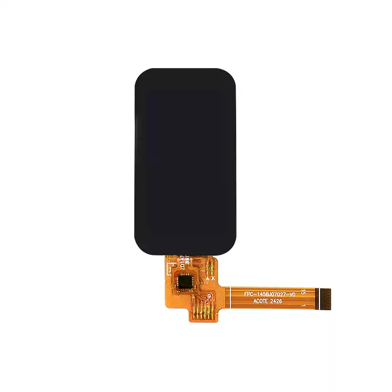

<p align="left"></p>

<h1 align="center">OSPTEK 1.47″ TFT Display 172×320 (YDP147BT001-V12)</h1>

<p align="center"><b>TFT module · SPI · JD9853</b></p>

<p align="center"><a href="./README.md">简体中文</a> | English · <a href="../../README_EN.md">Family index</a></p>

<p align="center">
  
  
</p>

<p align="center"></p>

## Contents

- [Specifications](#specifications)
- [Resources](#resources)
- [Repository layout](#repository-layout)
- [Buy](#buy)
- [Support](#support)

---

## Specifications

| Item | Spec |
| ---- | ---- |
| Size | 1.47 inch |
| Type | TFT |
| Resolution | 172×320 |
| Outline | 19.39 x 36.28 mm |
| Active area | 17.39 x 32.35 mm |
| Interface | SPI |
| Driver IC | JD9853 |
| Touch IC | — |

> Full outline, FPC definition, power, and timing follow the product datasheet / driver IC datasheet.

## Resources

| Category | File |
| ---- | ---- |
| Datasheet | [`JD9853_DS_Preliminary_V0.00_20230424.pdf`](./datasheets/JD9853_DS_Preliminary_V0.00_20230424.pdf) |
| Datasheet | [`CST_08_C_V1_0_c0ecd3b568.pdf`](./datasheets/CST_08_C_V1_0_c0ecd3b568.pdf) |
| Datasheet | [`CST_816_T_v1_3_1_69c246954d.pdf`](./datasheets/CST_816_T_v1_3_1_69c246954d.pdf) |
| Datasheet | [`YDP147BT001-V12.pdf`](./datasheets/YDP147BT001-V12.pdf) |
| CAD file | [`YDP147BT001-V12.dwg`](./cad/YDP147BT001-V12.dwg) |
| Adapter materials | [`YDP147BT001-V12_转接板原理图.png`](./adapter/YDP147BT001-V12_%E8%BD%AC%E6%8E%A5%E6%9D%BF%E5%8E%9F%E7%90%86%E5%9B%BE.png) |

## Repository layout

```text
display-tft-1.47inch-172x320/ # repo root (nav: ../../README_EN.md; sample projects under root examples/)
└── versions/
    └── YDP147BT001-V12/        # full materials for this part number
        ├── README.md
        ├── README_EN.md
        ├── osptek.yml
        ├── images/
        ├── datasheets/       # product datasheet + driver/touch IC datasheets
        ├── cad/              # outline/cover CAD
        └── adapter/          # adapter board materials + photos
```

## Buy

See the [repo home page](../../README_EN.md#where-to-buy).

## Support

See the [repo home page](../../README_EN.md#support).

---

<p align="center"><sub>© 2026 OSPTEK · Materials in this repository are licensed under CC BY 4.0</sub></p>
