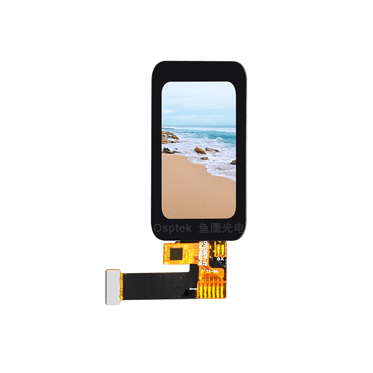

<p align="left"></p>

<h1 align="center">OSPTEK 1.47″ TFT Display 172×320 (YDP147HT001-V3)</h1>

<p align="center"><b>TFT module · MCU · ST7789</b></p>

<p align="center"><a href="./README.md">简体中文</a> | English · <a href="../../README_EN.md">Family index</a></p>

<p align="center">
  
  
</p>

<p align="center"></p>

## Contents

- [Specifications](#specifications)
- [Resources](#resources)
- [Repository layout](#repository-layout)
- [Buy](#buy)
- [Support](#support)

---

## Specifications

| Item | Spec |
| ---- | ---- |
| Size | 1.47 inch |
| Type | TFT |
| Resolution | 172×320 |
| Outline | 19.39 x 36.28 x 1.46 mm |
| Active area | 17.3892 x 32.352 mm |
| Interface | MCU |
| Driver IC | ST7789 |
| Touch IC | — |

> Full outline, FPC definition, power, and timing follow the product datasheet / driver IC datasheet.

## Resources

| Category | File |
| ---- | ---- |
| Datasheet | [`ST7789V3_SPEC_Preliminary_V0.0_200102.pdf`](./datasheets/ST7789V3_SPEC_Preliminary_V0.0_200102.pdf) |
| Datasheet | [`CST_816_D_V1_0_2_1b06dfb078.pdf`](./datasheets/CST_816_D_V1_0_2_1b06dfb078.pdf) |
| Datasheet | [`YDP147H001-V3.pdf`](./datasheets/YDP147H001-V3.pdf) |
| Datasheet | [`YDP147HT001-V3.pdf`](./datasheets/YDP147HT001-V3.pdf) |
| CAD file | [`YDP147H001-V3.dwg`](./cad/YDP147H001-V3.dwg) |
| CAD file | [`YDP147HT001-V3 外形图.pdf`](./cad/YDP147HT001-V3%20%E5%A4%96%E5%BD%A2%E5%9B%BE.pdf) |
| CAD file | [`YDP147HT001-V3.dwg`](./cad/YDP147HT001-V3.dwg) |
| CAD file | [`YDP147HT001-V3总成图.dwg`](./cad/YDP147HT001-V3%E6%80%BB%E6%88%90%E5%9B%BE.dwg) |

## Repository layout

```text
display-tft-1.47inch-172x320/ # repo root (nav: ../../README_EN.md; sample projects under root examples/)
└── versions/
    └── YDP147HT001-V3/        # full materials for this part number
        ├── README.md
        ├── README_EN.md
        ├── osptek.yml
        ├── images/
        ├── datasheets/       # product datasheet + driver/touch IC datasheets
        └── cad/              # outline/cover CAD
```

## Buy

See the [repo home page](../../README_EN.md#where-to-buy).

## Support

See the [repo home page](../../README_EN.md#support).

---

<p align="center"><sub>© 2026 OSPTEK · Materials in this repository are licensed under CC BY 4.0</sub></p>
